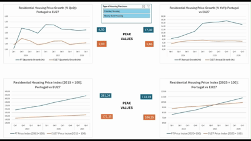

# Portugal vs. EU. Residential Housing Price Analysis



A macro housing analytics dashboard built in **Microsoft Excel**, **Power Query (M)**, and **Power Pivot (DAX)**, analyzing Portugal's residential real estate price trajectory against the European Union aggregate (`EU27_2020`). Short-term quarterly momentum, annual growth rates and cumulative price index levels are addressed across different dwellings. 

## Analytical Objectives

The main objective of this study is to portrait and evaluate how Portugal's residential purchase price growth compares agaisnt the broader EU27 baseline across recent market regimes. We separate metrics based on either percentage rates of change ( Quarterly, Annualy ) or cumulative index series (2015, 2025) with the addition of dwelling-based filters to discuss differences in **Existing Housing** and **Newly Built Housing** prices.  

## Results

Across both quarterly momentum (`RCH_Q`) and annual growth (`RCH_A`), Portugal's residential housing market has consistently outpaced the EU27 average. In the existing housing segment, Portugal's quarterly price gains repeatedly cleared the `3.0%–4.5%` range while EU27 quarterly growth moderated closer to `1.0%–1.5%`, pushing Portugal's annual growth peak above `17%` compared to roughly `5.65%` across the EU27. Looking at the long-run `2015 = 100` index (`I15_Q`), cumulative residential prices in Portugal have more than doubled climbing above `280`whereas the EU27 index advanced more gradually toward `172`. Portugal experienced only a brief moderation in early 2024 before re-accelerating sharply through 2025 and into 2026 (`2025 = 100` index reaching `~113` vs. `~104` for EU27). 

## ETL (Power Query)

All of the data used was sourced from Eurostat Database [1]. Transformed all tables in Power Query and loaded directly to **Excel Data Model** as a connection-only query to maintain performance and eliminate redudant flat tables.
Filtered geographic entities to focus on Portugal (`PT`) and the EU benchmark (`EU27_2020`), Isolated true segment dynamics for purchase types to compare different dwelling types, parsed quarterly string periods into chronological `quarter_date` field for accurate time-sorting across Pivot Charts and preserved relevant Eurostat metadata columns for data lineage and auditability.   

## Data Modeling and DAX Measures (Power Pivot)

To ensure metric hygiene and avoid implicit PivotTable aggregation errors, explicit DAX measures were implemented on the fact table (`prc_hpi_q_qrc_total`):

###  - Core Country & Unit Series Measures

Isolated each country (`PT` vs. `EU27_2020`) and unit series (`RCH_Q`, `RCH_A`, `I15_Q`, `I25_Q`) inside `CALCULATE` blocks:

* **Quarterly Rate of Change (`RCH_Q`):** `PT Quarterly Growth (%)` and `EU27 Quarterly Growth (%)`
* **Annual Rate of Change (`RCH_A`):** `PT Annual Growth (%)` and `EU27 Annual Growth (%)`
* **Cumulative Index (2015 = 100, `I15_Q`):** `PT Price Index (2015 = 100)` and `EU27 Price Index (2015 = 100)`
* **Cumulative Index (2025 = 100, `I25_Q`):** `PT Price Index (2025 = 100)` and `EU27 Price Index (2025 = 100)`

###  - Dynamic Peak (`MAX`) KPI Measures

Rather than using static chart data labels that remain anchored to outdated points when slicers change, dynamic peak measures were built using `MAXX` over active `VALUES` context:

```dax
PT Peak QoQ (%) :=
MAXX(
    VALUES(prc_hpi_q_qrc_total[quarter_date]),
    CALCULATE([PT Quarterly Growth (%)])
)
```
 
*(Parallel peak measures were implemented across YoY growth and both index base years for both Portugal and EU27.)*

## Dashboard and Visual Design

* **Decoupled Calculation Layer:** Placed all underlying PivotTables on a dedicated helper sheet (`Calc_KPIs`) with **Autofit column widths on update** disabled to eliminate PivotTable spill collisions on the presentation layer.
* **2x2 Executive Chart Grid:**
  * **Top Row (Momentum & Trend):** Quarterly Growth (`% QoQ`) paired alongside Annual Growth (`% YoY`).
  * **Bottom Row (Cumulative Price Levels):** Long-run Index (`2015 = 100`) paired alongside Current Reference Index (`2025 = 100`).
* **Unified Interactivity:** Connected a single `Type of Housing` slicer across all four chart PivotTables and the summary KPI PivotTable via **Report Connections**.
* **Dynamic KPI Callouts:** Linked color-coded KPI cards (Portugal in teal/blue, EU27 in orange) directly to the isolated KPI PivotTable cells (`Generate GetPivotData` disabled for clean cell referencing). 

## Analytical Caveats

Recent quarterly figures are subject to standard Eurostat statistical revisions as national statistical institutes finalize transaction registries. 

## Bibliography

* Source: Eurostat, House price index - quarterly data (prc_hpi_q), DOI: 10.2908/prc_hpi_q (accessed 2026-11-24). 

## Notes

